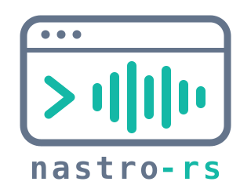

<div align="center">



**A call recorder for the terminal. No bots, no cloud.**

System audio + mic capture, local files, on-device transcription, and speaker labels when you want them.

[](https://github.com/SpryDynamics/nastro-rs/releases) [](LICENSE) 



<sub>The animation is the real interface running on sample recordings, generated by <code>eng/render-demo.ps1</code>.</sub>

</div>

---
# nastro-rs

A Rust port of [scaccogatto/nastro](https://github.com/scaccogatto/nastro) - a
terminal-native call recorder (system audio + mic, local files, on-device
transcription) - retargeted from **macOS-only** to **Windows + Linux**.

> **Status: recording, browsing and transcription work.** Run `nastro` for a
> full-screen terminal UI (browse, record, transcribe, filter, delete to the
> Recycle Bin, reveal in Explorer), `nastro record` for headless recording, or
> `nastro transcribe last` to turn the newest recording into text, entirely on
> this computer. Capture is verified against real hardware on Windows (WASAPI). On
> Linux it has run against a real PulseAudio-protocol server (WSLg on Ubuntu
> 24.04): mic and system capture both opened and produced valid files, but only
> silence was observed, so audio *content* and a native PipeWire/PulseAudio
> desktop are still unverified. Recordings are AAC/.m4a (fragmented MP4, so
> they survive a crash) via an external `ffmpeg`. Transcription is verified on
> Windows and Linux (real model, real speech). Speaker labels (`[SPEAKER_00]`) are
> available through the optional external WhisperX tool. See
> [`CHANGELOG.md`](CHANGELOG.md) for exact scope and [`docs/`](docs/) for the
> phased build plan.

## Why a port, and why these platform/format choices

The original project is excellent but deliberately macOS-only: its audio capture
leans on CoreAudio's process-tap API (Swift), and several supporting pieces
(`afconvert`, `caffeinate`, Homebrew-based installers, `~/.Trash`, POSIX file modes)
are macOS-specific. This port keeps the overall architecture - two cooperating
processes (`nastro` the CLI/TUI, `nastro-tap` the capture helper) talking over
stdio, filesystem-as-database record storage, crash-safe incremental writes - while
replacing every macOS-specific piece with a Windows/Linux-native equivalent:

| Concern | Original (macOS) | This port |
| --- | --- | --- |
| System audio capture | CoreAudio process tap | WASAPI loopback (Windows) / PulseAudio monitor source (Linux) |
| Audio container | AVAudioFile → AAC/.m4a | `ffmpeg` subprocess, fragmented MP4 for crash safety |
| Resample for transcription | `afconvert` | `ffmpeg` subprocess (reuses the muxing dependency) |
| Transcription | shells out to Homebrew-installed `whisper-cli`/`whisperx` | embedded `whisper-rs` (whisper.cpp) - no external installer; `whisperx` kept as an optional external tool for speaker labels |
| Anti-sleep | `caffeinate` | `SetThreadExecutionState` (Windows) / best-effort `systemd-inhibit` (Linux) |
| Trash on delete | `~/.Trash` | `trash` crate (Recycle Bin / freedesktop trash spec) |
| TUI | Bubble Tea (Go) | `ratatui` |

See `NOTICE.md` for attribution to the original project.

## Workspace layout

```
crates/
  nastro-config/   TOML config load/defaults (done)
  nastro-records/  filesystem-as-database scan/formatting (done)
  nastro-record/   recording session orchestration (done)
  nastro-audio/    capture/mixer core + platform backends (done; Windows-verified, Linux verified on WSLg PulseAudio)
  nastro-tui/      ratatui screens + state machine (done)
  nastro-transcribe/  on-device speech-to-text: embedded whisper.cpp, model download + verification (done)
bin/
  nastro/          CLI/TUI entry point
  nastro-tap/      capture helper (spawned by nastro, talks over stdio)
```

> This GitHub repository is a read-only mirror of the Azure DevOps source of truth; see
> [`docs/releasing.md`](docs/releasing.md#github-mirror).

## Install

Download a release archive (see [`docs/releasing.md`](docs/releasing.md)), check it
against `SHA256SUMS`, and unpack it. Keep `nastro` and `nastro-tap` in one folder. The
Windows binaries are signed by Spry Dynamics, LLC. Nothing is installed system-wide.

## Requirements

- **FFmpeg** on `PATH` (or set `NASTRO_FFMPEG` to the executable). It is run as a
  separate process to encode AAC/.m4a and to read recordings back for transcription,
  and is not bundled - see [`NOTICE.md`](NOTICE.md). Windows:
  `winget install Gyan.FFmpeg`; Debian/Ubuntu: `sudo apt install ffmpeg`.
- **For transcription**: an x86-64 CPU with AVX2 (anything from about 2013), and for
  the default model about 2.5 GB of free memory. The speech engine is built in; the
  speech *model* is downloaded on first use (see [Transcription](#transcription)).

## Build

Transcription embeds [whisper.cpp](https://github.com/ggml-org/whisper.cpp), which Cargo
compiles from source, so building needs **CMake**, a **C/C++ compiler** and **libclang**
(for the Rust bindings):

```powershell
# Windows: Visual Studio Build Tools (C++ workload) already provide CMake; add LLVM for libclang
winget install LLVM.LLVM          # then: $env:LIBCLANG_PATH = "C:\Program Files\LLVM\bin"
```
```bash
# Debian/Ubuntu
sudo apt-get install -y cmake clang libclang-dev
```

**Linux only**: also install the PulseAudio dev headers/libs (needed to link
`nastro-audio`'s system-audio/mic backend):
```bash
sudo apt-get install -y libpulse-dev   # Debian/Ubuntu
# or: sudo dnf install -y pulseaudio-libs-devel   # Fedora
```

`.cargo/config.toml` pins the whisper.cpp build to a portable x86-64 baseline (AVX2) and
restores optimisation flags the `cmake` crate would otherwise drop on MSVC (without them
transcription is about 10x slower); read the comments there before changing it.

```powershell
cargo build --workspace
cargo test --workspace
cargo clippy --workspace --all-targets -- -D warnings
cargo fmt --all -- --check
./eng/check-licenses.ps1   # cargo-deny: licenses/advisories/bans/sources
```

## Try it

```powershell
cargo run --bin nastro                                   # the TUI
cargo run --bin nastro -- records --plain                # scriptable, tab-separated
cargo run --bin nastro -- record --name "Weekly Sync"    # headless; Ctrl+C stops & saves
cargo run --bin nastro -- transcribe last                # speech to text for the newest recording
```

When stdin/stdout isn't a terminal (piped, redirected), `nastro` and
`nastro records` print the plain table instead of opening the TUI.

### TUI keys

| Key | Action |
| --- | --- |
| `r` | record (name + capture mode; `Tab` cycles system+mic / mic only / system only) |
| `s` / `q` / `Ctrl+C` | stop and save (while recording; under 2 seconds is discarded) |
| `x` | discard the live recording (asks first) |
| `Enter` | open a recording (shows a transcript preview if one exists) |
| `t` | transcribe the selected recording in the background (asks before replacing a transcript or downloading a model) |
| `c` | cancel the selected recording's transcription |
| `o` | reveal in Explorer / file manager |
| `d` | delete to the Recycle Bin / Trash (asks first; only `y` confirms) |
| `/` | filter by name |
| `j` `k` / arrows, `g` `G` | move, first, last |
| `?` | help |
| `q` / `Esc` | back / quit |

Delete never falls back to a permanent delete: if the Recycle Bin / Trash can't be
used you get an error and nothing is removed.

**Colors** come from your terminal's own theme: nastro only uses the 16 ANSI colors (cyan for the selection and titles,
dim gray for secondary text, red for recording and anything destructive), so it matches whatever palette you run, light
or dark. Set `NO_COLOR` (or use a `dumb` terminal) for no color at all; bold text and the `▸` selection marker still
show where you are.

### Transcription

```powershell
nastro transcribe last                 # or a recording id (its folder name)
nastro transcribe last --model small   # a smaller, faster model
nastro transcribe --list-models        # what can be downloaded, and what is installed
```

It writes `transcript.txt` (one phrase per line) and `transcript.srt` (with timestamps)
next to `audio.m4a`; the TUI shows the text in the recording's detail view. It runs
**entirely on this computer**: nothing is uploaded, and after the one-time model
download it works offline.

- **Models** are Whisper models in ggml format, downloaded on first use from
  `huggingface.co/ggerganov/whisper.cpp` (pinned to an exact revision) and checked against a
  SHA-256 built into nastro before use; a corrupted or tampered download is discarded.
  nastro always asks before downloading (`--yes` to skip the question). They are kept in
  `~/.cache/whisper` (Linux) / `%LOCALAPPDATA%\whisper` (Windows), or `$NASTRO_MODEL_DIR`. The
  default, `large-v3-turbo`, is about 1.5 GB; `base`/`small` (and the `-q5` quantised variants) are
  much smaller and faster, and `.en` models are English-only. `whisper_model` can also be a path to a
  ggml `.bin` file.
- **Speed**: on CPU, the default model runs at roughly 2x real time on a 16-core desktop
  (3:40 of audio in about 1m50s) and needs ~2.1 GB of memory. Smaller models are far faster: the
  `tiny.en` model did the same recording in under 10 seconds, at lower accuracy.
  Threads default to the number of physical cores and cannot be set higher than that: whisper.cpp's
  threads spin-wait on each other, and using every hardware thread makes it collapse to a crawl
  rather than speed up. GPU acceleration is not used yet.
- **Safe to interrupt**: Ctrl+C (or `c` in the TUI) cancels within a fraction of a second. A
  transcript is only ever replaced once the new one is complete, so a cancelled or failed
  run leaves any existing transcript untouched.
- A recording that is still being recorded cannot be transcribed; silence gives an empty
  transcript rather than invented words.

### Speaker labels (WhisperX)

To get `[SPEAKER_00]` / `[SPEAKER_01]` labels (who said what), use the optional WhisperX engine:

```powershell
nastro transcribe --setup-whisperx                       # one time: installs WhisperX (with uv) and its data
nastro transcribe last --transcriber whisperx            # or set  transcriber = "whisperx"  in the config
nastro transcribe last --transcriber whisperx --speakers 2   # telling it how many people helps
```

```
[SPEAKER_00] Good morning everyone. Let's start the weekly planning meeting.
[SPEAKER_01] Thanks. The new release is on track.
```

`transcript.txt` has one line per run of consecutive same-speaker phrases, and `transcript.srt` the same with timestamps.
In the TUI, `t` uses whichever engine the `transcriber` setting selects.

It is heavier than the built-in engine, which is why it is optional:

- **A Hugging Face account.** The speaker models are *gated*: create a free **read** token at
  <https://huggingface.co/settings/tokens>, accept the terms on
  <https://huggingface.co/pyannote/speaker-diarization-community-1>, and put the token in the config
  (`hf_token = "hf_..."`) or the `HF_TOKEN` environment variable. The token is handed to WhisperX through its
  environment only (never on a command line, where other users could see it) and is scrubbed from any error text.
  Treat the config file like any file holding a credential; the environment variable avoids storing it at all.
- **About 2 GB to install** (Python, PyTorch, pyannote) plus several GB of models downloaded on first use, into
  your Hugging Face cache. It installs for your user only, via [`uv`](https://docs.astral.sh/uv/)
  (`winget install astral-sh.uv`); `--setup-whisperx` asks nothing else and does it for you.
- **CPU only and slow**: a multiple of the recording length with the default model; it shows which stage it is in
  (detecting speech, transcribing, aligning, identifying speakers) because WhisperX reports no percentage. Use a
  smaller `--model` (`small`, `base`) for speed.
- `whisper_model` must be a plain model name here (`small`, `large-v3-turbo`, ...), not a file path; quantised ggml
  names such as `base-q5_1` map to the full model. WhisperX fetches its own copy.
- Cancelling stops WhisperX and everything it started, and leaves any existing transcript untouched.

### Config

`--config <path>` (or the `NASTRO_CONFIG` environment variable) selects a config
file explicitly; a file you name that fails to parse is an error rather than a
silent fall back to defaults. Otherwise config is read from `%APPDATA%\nastro\config.toml` (Windows) /
`~/.config/nastro/config.toml` (Linux); see `nastro-config`'s `ConfigFile` for the
available keys. A missing config file is not an error - sane defaults apply
(`~/Recordings/nastro`, `large-v3-turbo`, etc.). The transcription keys are `whisper_model`
(a model name or path), `lang` (`auto` or a code such as `en`), `transcriber` (`whisper`, or `whisperx` for speaker
labels), `hf_token` (for `whisperx`; or `HF_TOKEN`) and `max_parallel_transcriptions` (how many the TUI runs at
once; default 2).

## Contributing

Issues and pull requests are welcome; please read [CONTRIBUTING.md](CONTRIBUTING.md) first (this repository is a mirror,
so PRs are ported by hand). Report security problems privately, see [SECURITY.md](SECURITY.md).

## License

MIT, see [`LICENSE`](LICENSE). This is an independent reimplementation (see
[`NOTICE.md`](NOTICE.md)) - no source from the original project is copied.
Third-party Rust dependency licenses are tracked in
[`THIRD_PARTY_NOTICES.md`](THIRD_PARTY_NOTICES.md) and gated in CI via `cargo-deny`
(`deny.toml`).
